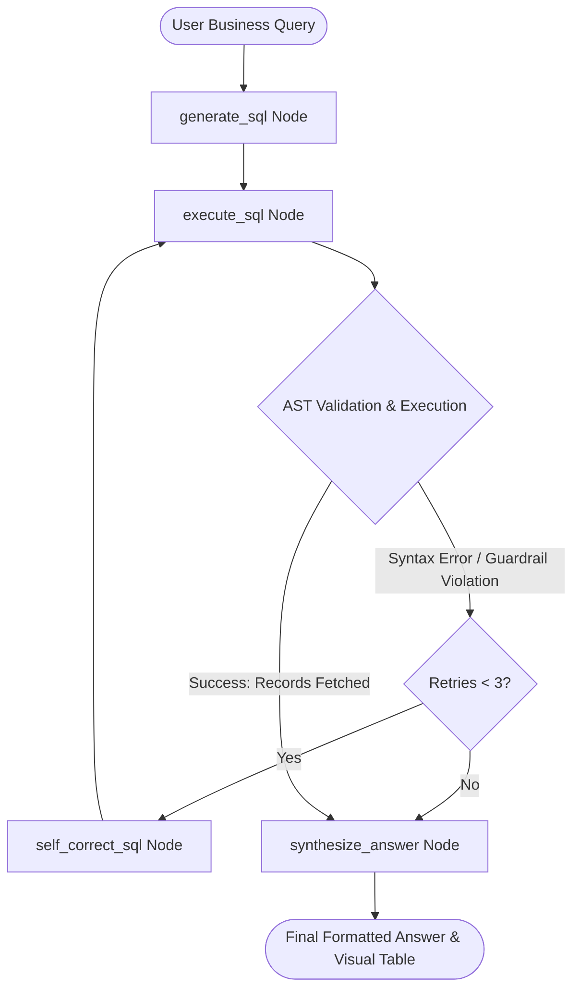

# Autonomous Self-Correcting SQL Analyst Agent

[](https://www.python.org/downloads/)
[](https://github.com/langchain-ai/langgraph)
[](https://github.com/tobymao/sqlglot)
[](https://fastapi.tiangolo.com/)
[](https://streamlit.io/)
[](LICENSE)

An enterprise-ready, stateful Agentic AI system that translates natural language business queries into verified SQL dialects. Built on **LangGraph**, the agent features an autonomous **Reflexion (self-healing) loop** that inspects database runtime exceptions, diagnoses schema or syntax errors, and iteratively corrects its own queries prior to execution.

Destructive mutations and SQL injection attempts are deterministically blocked before hitting the database engine using **Abstract Syntax Tree (AST) guardrails** powered by `sqlglot`.

---

## Key Architectural Highlights

* **Autonomous Self-Reflection (Reflexion Loop):** When query execution throws an error (syntax mismatch, missing join, invalid column), the state machine captures `stderr` and re-enters a debugging node with capped retries ($N=3$), preventing cascading failure.
* **AST-Level Security Guardrails:** Query authorization is enforced at the Abstract Syntax Tree parser layer via `sqlglot` rather than naive string blacklists. Only read-only operations (`SELECT`) are executed; DDL/DML mutations (`DROP`, `DELETE`, `INSERT`, `ALTER`) are blocked deterministically.
* **Stateful Thread Checkpointing:** Built-in session state persistence via LangGraph's checkpointer mechanism (`MemorySaver`), enabling multi-turn context preservation and conversation isolation by `thread_id`.
* **Provider-Agnostic LLM Routing:** Dynamic model switching supporting Google Gemini (`gemini-2.5-flash`), OpenAI (`gpt-4o-mini`), and local models (Ollama / Qwen) via clean environment configuration.
* **Automated Quantitative Evaluation Suite:** Includes a dedicated evaluation benchmark to measure execution accuracy, ground-truth answer verification, and autonomous error recovery rate.

---

## Architecture Flow



---

## Directory Structure

```text
sql-analyst-agent/
├── .env.example              # Template for environment credentials
├── Dockerfile                 # Container image specification
├── docker-compose.yml         # Multi-container orchestration (API + UI)
├── requirements.txt           # Project dependencies
├── README.md                  # Project documentation
├── db_setup.py                # Database population script
├── app/
│   ├── __init__.py
│   ├── config.py              # Pydantic BaseSettings environment manager
│   ├── database/
│   │   ├── __init__.py
│   │   ├── connection.py      # Thread-safe queries and schema introspection
│   │   └── guardrails.py      # AST SQL validation & mutation prevention
│   ├── agent/
│   │   ├── __init__.py
│   │   ├── state.py           # TypedDict graph state & Pydantic output schemas
│   │   ├── prompts.py         # Versioned prompt templates
│   │   ├── nodes.py           # LangGraph execution nodes
│   │   └── graph.py           # Compiled StateGraph & checkpointer setup
│   ├── api/
│   │   ├── __init__.py
│   │   └── main.py            # FastAPI REST endpoints
│   └── ui/
│       ├── __init__.py
│       └── streamlit_app.py   # Interactive dashboard
└── tests/
    ├── __init__.py
    ├── test_guardrails.py     # Pytest unit tests for AST security
    ├── eval_dataset.json      # Evaluation benchmark dataset
    └── run_evals.py           # Benchmark runner
```

---

## Getting Started

### 1. Prerequisites
* Python 3.10 or higher
* A Gemini API key (or OpenAI / Groq / Ollama instance)

### 2. Environment Setup

Clone the repository and create an isolated virtual environment:

```bash
git clone https://github.com/your-username/sql-analyst-agent.git
cd sql-analyst-agent

python -m venv .venv

# On Linux/macOS:
source .venv/bin/activate

# On Windows PowerShell:
.\.venv\Scripts\Activate.ps1
```

Install dependencies:

```bash
pip install -r requirements.txt
```

### 3. Configure Credentials

Copy the environment template and populate your keys:

```bash
cp .env.example .env
```

Edit `.env`:

```env
GEMINI_API_KEY=your_gemini_api_key_here
LLM_PROVIDER=gemini
LLM_MODEL=gemini-2.5-flash
DATABASE_PATH=store.db
MAX_RETRIES=3

# Optional: LangSmith Tracing
LANGCHAIN_TRACING_V2=false
LANGCHAIN_API_KEY=
LANGCHAIN_PROJECT=sql-analyst-production
```

### 4. Initialize Database

Run the database setup script to generate and populate `store.db`:

```bash
python db_setup.py
```

---

## Running the Application

### Option A: Interactive Streamlit Dashboard

Launch the web interface for real-time querying, visual inspection of SQL queries, reflection counts, and data tables:

```bash
streamlit run app/ui/streamlit_app.py
```

Open your browser at `http://localhost:8501`.

### Option B: FastAPI Backend

Expose the agent as a production REST API:

```bash
uvicorn app.api.main:api --reload --port 8000
```

Access the interactive OpenAPI (Swagger) documentation at `http://localhost:8000/docs`.

#### Sample API Request:
```bash
curl -X POST "http://localhost:8000/query" \
     -H "Content-Type: application/json" \
     -d '{
       "session_id": "session-101",
       "question": "Which customer spent the most money overall?"
     }'
```

### Option C: Docker Compose

Spin up both the FastAPI backend and Streamlit dashboard in isolated containers:

```bash
docker-compose up --build
```

---

## Testing & Evaluation

### Security Guardrail Tests
Run the unit tests verifying that destructive commands, statement chaining, and SQL injection vectors are caught by the AST parser:

```bash
pytest tests/test_guardrails.py -v
```

### Benchmark Evaluation Suite
Measure quantitative query performance across golden benchmark test cases:

```bash
python tests/run_evals.py
```

#### Benchmark Metrics Output:
```text
==================================================
Total Evaluations:   10
Accuracy Rate:       90.0%
Self-Healed Cases:   2
Autonomous Recovery: 100.0%
==================================================
```

---

## Engineering Highlights for Resume

* **LangGraph State Machine:** Engineered a cyclical directed graph handling structured outputs, schema reflection, and multi-node execution with deterministic fallback criteria.
* **AST Query Sandboxing:** Enforced strict read-only guarantees using `sqlglot` AST traversal, intercepting potential injections and destructive clauses prior to database evaluation.
* **Reflexion Architecture:** Automated error trace consumption to iteratively repair query errors without human intervention, boosting execution success rates on complex joins.
* **CI/CD Quality Gates:** Integrated automated test suites verifying guardrail integrity and empirical LLM accuracy benchmarks on real-world SQL schemas.

---

## License

This project is licensed under the MIT License - see the [LICENSE](LICENSE) file for details.